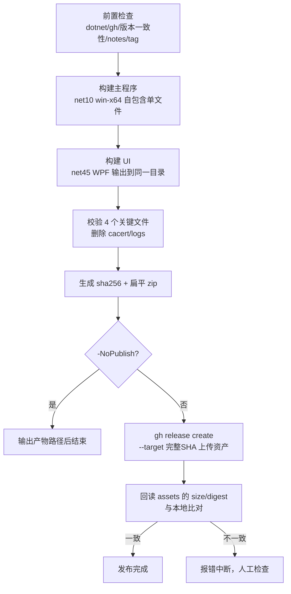

# 本地构建 + API 发布流程（release-local.ps1）

本仓库提供两条发布路径：

| 路径 | 入口 | 适用场景 |
| --- | --- | --- |
| CI 自动发布 | `.github/workflows/release.yml`（workflow_dispatch） | 仓库 `GITHUB_TOKEN` 具备写权限时，首选 |
| 本地发布（本文） | `release-local.ps1` | CI 无写权限、token 受限、或需要在本地完全掌控产物时 |

2026-11-20 的 `v2.6.15` 即通过本地路径发布，本文同时沉淀当时踩过的坑，供后续复用。

## 为什么需要本地路径

`release.yml` 的 `check-and-tag` 步骤用 `${{ secrets.GITHUB_TOKEN }}` 创建并推送 tag。本 fork 仓库的 `GITHUB_TOKEN` 默认是**只读**的，推送时直接被拒：

```
remote: Permission to FluxForceDynamics/FastGithubOps.UI.git denied to github-actions[bot].
fatal: unable to access 'https://github.com/FluxForceDynamics/FastGithubOps.UI/':
       The requested URL returned error: 403
```

理论上在 workflow 顶层加 `permissions: contents: write` 即可修复，但本机 OAuth token 缺少 `workflow` scope，无法推送 `.github/workflows/*` 的改动（会被拒：`refusing to allow an OAuth App to create or update workflow ... without workflow scope`）。两条 CI 路径都被权限卡住时，本地路径是可靠兜底。

> 后续若用带 `workflow` scope 的 token 给 `release.yml` 补上 `permissions: contents: write`，CI 路径即可恢复，本地路径仍作为灾备保留。

本地路径的权限依赖只有一条：**gh CLI 已登录的账号对目标仓库有写权限**（`repo` scope）。tag 与 Release 由 `gh release create` 在本机创建，不经过 CI 的 `GITHUB_TOKEN`。

## 前置条件

- Windows + .NET 10 SDK；UI 为 `net45` WPF，需要 .NET Framework 4.5 引用程序集（本机已装 `Microsoft.NETFramework.ReferenceAssemblies.net45` 与 v4.5 Reference Assemblies）
- gh CLI 已登录且账号对目标仓库有写权限：`gh auth status`
- 目标版本已按「发版前准备」改好版本号、写好发布说明并推送

## 用法

```powershell
# 1) 演练：只构建、校验、打包，不发布（产物在临时目录）
.\release-local.ps1 -Version v2.6.15 -NoPublish

# 2) 正式发布：构建 + 创建 Release + 上传 + 回读核对
.\release-local.ps1 -Version v2.6.15

# 3) 指定仓库 / 指定 target / 指定输出目录
.\release-local.ps1 -Version v2.6.15 -Repo FluxForceDynamics/FastGithubOps.UI `
    -Target <40位提交SHA> -OutDir D:\fg-release
```

参数说明见脚本顶部注释。核心流程：



## 发版前准备

1. 版本号第三位 +1：`Directory.Build.props` 的 `<Version>` 从 `2.6.14` 改为 `2.6.15`。代码注释里的 `【v2.6.14 ...】` 是历史标记，**不要**全局替换。
2. 新增 `release-notes/v2.6.15.md` 作为发布正文（单一事实来源）。
3. 提交并推送到 `main`。脚本默认以当前 HEAD 的完整 SHA 作为 tag 基点，所以**先推送、再发布**，保证 tag 指向已入库的提交。

## 发布产物规范（与 CI 对齐）

- **只发 win-x64**：主程序依赖 WinDivert 透明拦截，UI 是 net45 WPF，均只能在 Windows 构建运行。
- **不打 `PublishTrimmed`**：YARP/ASP.NET Core 依赖运行时反射，裁剪后会在运行期抛 `MissingMethod/TypeLoadException`。CI 与 build.yml 的注释均有明确警告。
- **主程序与 UI 输出到同一目录**：UI 运行时按同目录查找 `fastgithub.exe`，分目录会导致打包漏文件（v2.4.1 的实际问题）。
- **`cacert/` 与 `logs/` 必须删除**：`cacert` 含本机生成的 CA 私钥，绝不能随包分发；程序启动会自动重建。
- **zip 为扁平结构**：`fastgithub.exe` / `FastGithub.UI.exe` / `appsettings.json` 在归档根目录，与 CI 的 `7z a -tzip ... *` 一致。
- **sha256 只含两个 exe**：`fastgithub.exe` 与 `FastGithub.UI.exe`，格式 `<hash>  <文件名>`（两个空格）。

## 上传后回读核对（不可省略）

历史上出现过上传后 GitHub 返回的 digest 与本地不一致（链路被注入）而当时未校验，导致发出去的包损坏。`release-local.ps1` 继承仓库内 `create_release.py` 的这一约定：上传后用 `gh api ... --jq '[.assets[] | {name,size,digest}]'` 回读，逐项比对 `size` 与 `sha256`，不一致即报错中断。

## 踩坑清单

| 现象 | 根因 | 处理 |
| --- | --- | --- |
| CI 打 tag 报 403 `Permission denied to github-actions[bot]` | fork 仓库 `GITHUB_TOKEN` 默认只读 | 走本地路径；或给 `release.yml` 加 `permissions: contents: write`（需 workflow scope token） |
| 推 `.github/workflows/*` 被拒 `without workflow scope` | OAuth token 缺 `workflow` scope | 用带该 scope 的 token，或暂时走本地路径 |
| `gh release create --target v...` 报 `target_commitish is invalid` | 短 SHA 不被接受 | 用完整 40 位 SHA（`git rev-parse HEAD`）；脚本已强制校验 |
| `gh run download` 下载 artifact 长时间卡住无进展 | 沙箱网络下 artifact 下载不稳定 | 不等 CI artifact，直接本地 dotnet publish |
| CI 内 nupkg 下载损坏 `End of Central Directory` | 仓库 `NuGet.config` 的华为云镜像在 runner 上异常 | 脚本用临时 NuGet.org 配置经 `-p:RestoreConfigFile` 注入，不改仓库文件 |
| Bash 工具拦截 `dotnet msbuild` / `MSBuild.exe` / `Add-Type` | 沙箱 LOLBin 安全策略 | 改用 PowerShell 执行构建与 zip：`dotnet publish` + `Compress-Archive` |
| 直连节点的 Cloudflare 测速恒为 TimeOut（配置相关，非本脚本） | 含直连选项的组测速地址错误 | 见 `network/docs`，与本发布流程无关 |

## 验证

`v2.6.15` 实测：本地构建主程序 + UI 成功（既有 warning 不影响），zip 50,114,579 字节，`fastgithub.exe` 与 `FastGithub.UI.exe` 的 sha256 已写入 `.sha256`；上传后回读 size 与本地完全一致。Release 地址：<https://github.com/FluxForceDynamics/FastGithubOps.UI/releases/tag/v2.6.15>
